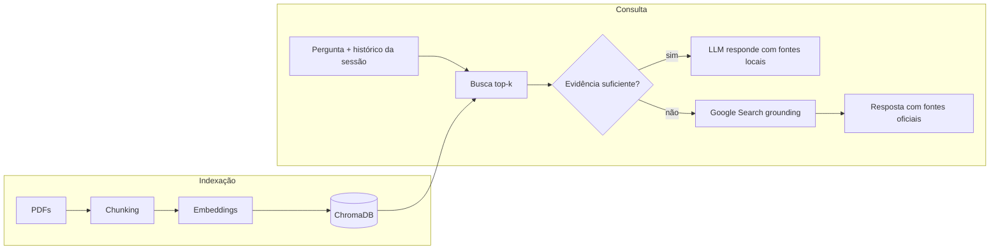

# 🌾 RAG Agro — Pergunte aos relatórios do mercado de grãos

[](https://github.com/LeoPinhelli/rag-relatorios-agro/actions/workflows/ci.yml)
[](https://www.python.org/)
[](LICENSE)

Chat que responde perguntas sobre relatórios públicos de safra (Conab, USDA),
**citando arquivo e página ou registro de cada resposta**.

> Problema: analistas gastam horas procurando números em PDFs de 50+ páginas.
> Solução: pergunte em português e receba a resposta com a fonte.

## Como funciona



1. **Indexação** (`make ingest`): lê PDFs por página e CSVs por registro, divide
   em trechos com sobreposição, gera embeddings multilíngues e salva no ChromaDB.
2. **Consulta** (`make app`): busca os trechos mais parecidos com a pergunta e
   envia ao LLM com a instrução de responder só com base neles.

No chat, PDF e Excel aparecem quando a pergunta pede um relatório, planilha ou
exportação. As respostas comuns mostram apenas a resposta e suas fontes. Registros
CSV são citados pelo número do registro; páginas PDF mantêm a citação por página.
Arquivos exportados incluem a pergunta, resposta e evidências recuperadas.

### Limpeza e metadados de documentos

A limpeza do texto é opcional e vem desativada por padrão (`CLEANING_ENABLED=false`).
Para testar, ative `CLEANING_ENABLED=true` no `.env` e reindexe com
`python -m rag_agro.ingest data/raw`. A limpeza remove linhas curtas repetidas
nas margens de pelo menos metade das páginas do mesmo PDF, recompõe palavras
quebradas por hífen na quebra de linha e normaliza espaços. Registros CSV não
passam pela regra de cabeçalho/rodapé.

O estágio de limpeza também infere `doc_type` e `year` do nome dos arquivos:
`conab` ou `boletim-de-safras` → `doc_type=conab`; `wasde` ou `wwcb` →
`doc_type=usda`; `operaciones_informadas` → `doc_type=sio_granos`. Anos com
quatro dígitos são reconhecidos em qualquer nome; padrões USDA como
`wasde1126.pdf` e `wwcb4526.pdf` também inferem 2026 pelo sufixo `MMYY` ou
`WWYY`. Para novos arquivos, prefira nomes com a fonte e o ano explícitos,
como `conab_boletim_safras_2026.pdf` e `usda_wasde_2026-11.pdf`.

## Stack

| Etapa | Ferramenta | Por quê |
|---|---|---|
| Leitura de PDF | pypdf | Leve, sem dependências nativas |
| Embeddings | sentence-transformers (multilíngue) | Gratuito, roda local, entende português |
| Banco vetorial | ChromaDB | Persistente em disco, zero infraestrutura |
| LLM | Gemini API ou Anthropic | Geração e busca online opcional com Gemini |
| Interface | Streamlit | Interface de chat para uso local ou deploy compatível |

## Rodando localmente

### Linux/macOS ou Git Bash

```bash
git clone https://github.com/LeoPinhelli/rag-relatorios-agro.git
cd rag-relatorios-agro
python -m venv .venv
source .venv/bin/activate
python -m pip install -e ".[dev]"
cp .env.example .env          # configure GEMINI_API_KEY no arquivo .env
# coloque PDFs públicos e CSVs compatíveis em data/raw/
python -m rag_agro.ingest data/raw
streamlit run app/streamlit_app.py
```

### Windows PowerShell

```powershell
git clone https://github.com/LeoPinhelli/rag-relatorios-agro.git
Set-Location rag-relatorios-agro
python -m venv .venv
Set-ExecutionPolicy -Scope Process -ExecutionPolicy Bypass
.\.venv\Scripts\Activate.ps1
python -m pip install -e ".[dev]"
Copy-Item .env.example .env  # configure GEMINI_API_KEY no arquivo .env
# coloque PDFs públicos e CSVs compatíveis em data/raw/
python -m rag_agro.ingest data/raw
streamlit run app/streamlit_app.py
```

Os comandos Python acima funcionam sem GNU Make, inclusive no Git Bash. No
PowerShell, a política de execução alterada com `Set-ExecutionPolicy -Scope
Process` vale somente para a sessão atual. Se preferir não ativar o ambiente
virtual, substitua `python` e `streamlit` pelos executáveis
`.venv\Scripts\python.exe` e `.venv\Scripts\streamlit.exe`.

### Chave do provedor

Copie `.env.example` para `.env` e configure `GEMINI_API_KEY` para Gemini. O
fallback de busca online requer `LLM_PROVIDER=gemini`; com Anthropic, o chat usa
somente os documentos locais. Nunca publique chaves de API.


Para a Conab, use a página [Acompanhamento da Safra Brasileira de Grãos](https://www.conab.gov.br/info-agro/safras/graos)
e baixe os PDFs mensais desse boletim — ignore documentos institucionais e de
políticas que não sejam relatórios de safra. Para o USDA, a página [WASDE
Report](https://usda.azureedge.us/about-usda/general-information/staff-offices/office-chief-economist/commodity-markets/wasde-report)
oferece cada edição em PDF, além de formatos de dados como XLS e XML. Este
projeto indexa PDFs e CSVs; salve os arquivos escolhidos em `data/raw/` e rode
`python -m rag_agro.ingest data/raw`. O CSV `operaciones_informadas.csv` do SIO
Granos é indexado como operações argentinas com quantidade, preço informado,
produto, safra, datas e localização. Consulte disponibilidade e período no próprio
arquivo: um recorte não representa a totalidade de farmer selling no Brasil.

No chat, perguntas como “Quais dados você pode fornecer?” descrevem o conteúdo
indexado. Para consultar o recorte, pergunte, por exemplo, “Forneça um relatório
com todos os dados da soja para novembro de 2026”. Os botões de PDF e Excel só
aparecem quando a pergunta pede explicitamente relatório, planilha ou exportação.

O arquivo `data/raw/operaciones_informadas.csv` é um recorte de operações
argentinas, não uma série completa de mercado. Os PDFs citados nos exemplos de
avaliação são dados externos: precisam ser obtidos pelo usuário e não são
versionados no Git. O script pessoal de coleta em `.local/`, quando existente,
também é ignorado e não faz parte da aplicação publicada.

## Memória da conversa e busca online

O histórico é mantido somente durante a sessão atual do Streamlit. Ele ajuda a
entender perguntas de seguimento, como “e o milho?”, mas não é salvo em disco nem
compartilhado com outras sessões. O botão **Limpar conversa** remove o histórico
da sessão.

Com `WEB_SEARCH_ENABLED=true`, o pipeline tenta responder primeiro com os
documentos indexados. Se o modelo indicar evidência insuficiente, faz uma segunda
chamada ao Gemini com Google Search grounding. As referências são extraídas dos
metadados de grounding e só são mostradas se todos os domínios citados estiverem
em `WEB_SEARCH_ALLOWED_DOMAINS`; respostas sem fontes oficiais verificáveis são
descartadas. A integração segue a [documentação oficial de Grounding com Google
Search](https://ai.google.dev/gemini-api/docs/google-search).

A pergunta e o contexto recuperado são enviados ao Google quando o fallback é
acionado. O grounding pode consumir cotas ou gerar cobranças conforme o projeto
e o modelo; confira os [termos e preços atuais](https://ai.google.dev/gemini-api/docs/pricing).
Use `WEB_SEARCH_ENABLED=false` para desativá-lo. A busca online é específica do
Gemini; Anthropic continua disponível para consultas locais.

## Estrutura

```
src/rag_agro/
  config.py       # configurações via .env
  schemas.py      # tipos compartilhados
  loaders.py      # 1. PDF -> páginas
  cleaning.py     # 2. limpeza opcional + metadados documentais
  chunking.py     # 3. páginas -> trechos
  vectorstore.py  # 4. embeddings + ChromaDB
  generator.py    # 5. prompt + LLM
  pipeline.py     # orquestra a consulta
  ingest.py       # CLI de indexação
app/              # interface Streamlit
evals/            # dataset e script de avaliação
tests/            # testes unitários (pytest)
```

## Decisões técnicas

- **IDs determinísticos** nos chunks: reindexar não duplica dados.
- **Metadados de fonte e página** em cada trecho: permitem citação.
- **Prompt restritivo**: o modelo diz "não encontrei" em vez de inventar.
- **Configuração externa**: modelo, chunk e top-k mudam sem tocar no código.

## Licença

MIT
