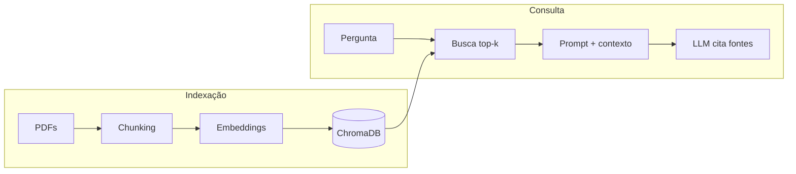

# 🌾 RAG Agro — Pergunte aos relatórios do mercado de grãos

Chat que responde perguntas sobre relatórios públicos de safra (Conab, USDA),
**citando arquivo e página de cada resposta**.

> Problema: analistas gastam horas procurando números em PDFs de 50+ páginas.
> Solução: pergunte em português e receba a resposta com a fonte.

 <!-- grave um GIF de 20s e coloque aqui -->

## Como funciona



1. **Indexação** (`make ingest`): lê PDFs por página e CSVs por registro, divide
   em trechos com sobreposição, gera embeddings multilíngues e salva no ChromaDB.
2. **Consulta** (`make app`): busca os trechos mais parecidos com a pergunta e
   envia ao LLM com a instrução de responder só com base neles.

No chat, PDF e Excel aparecem quando a pergunta pede um relatório, planilha ou
exportação. As respostas comuns mostram apenas a resposta e suas fontes. Registros
CSV são citados pelo número do registro; páginas PDF mantêm a citação por página.
Arquivos exportados incluem a pergunta, resposta e evidências recuperadas.

## Stack

| Etapa | Ferramenta | Por quê |
|---|---|---|
| Leitura de PDF | pypdf | Leve, sem dependências nativas |
| Embeddings | sentence-transformers (multilíngue) | Gratuito, roda local, entende português |
| Banco vetorial | ChromaDB | Persistente em disco, zero infraestrutura |
| LLM | Gemini API ou Claude (Anthropic) | Permite testar com cota gratuita do Gemini |
| Interface | Streamlit | Deploy grátis no Streamlit Cloud |

## Rodando localmente

### Linux/macOS ou Git Bash

```bash
git clone https://github.com/LeoPinhelli/rag-relatorios-agro.git
cd rag-relatorios-agro
python -m venv .venv
source .venv/bin/activate
python -m pip install -e ".[dev]"
cp .env.example .env          # configure GEMINI_API_KEY no arquivo .env
# coloque PDFs públicos e CSVs compatíveis em data/raw/
python -m rag_agro.ingest data/raw
streamlit run app/streamlit_app.py
```

### Windows PowerShell

```powershell
git clone https://github.com/LeoPinhelli/rag-relatorios-agro.git
Set-Location rag-relatorios-agro
python -m venv .venv
Set-ExecutionPolicy -Scope Process -ExecutionPolicy Bypass
.\.venv\Scripts\Activate.ps1
python -m pip install -e ".[dev]"
Copy-Item .env.example .env  # configure GEMINI_API_KEY no arquivo .env
# coloque PDFs públicos e CSVs compatíveis em data/raw/
python -m rag_agro.ingest data/raw
streamlit run app/streamlit_app.py
```

Os comandos Python acima funcionam sem GNU Make, inclusive no Git Bash. No
PowerShell, a política de execução alterada com `Set-ExecutionPolicy -Scope
Process` vale somente para a sessão atual. Se preferir não ativar o ambiente
virtual, substitua `python` e `streamlit` pelos executáveis
`.venv\Scripts\python.exe` e `.venv\Scripts\streamlit.exe`.

### Chave gratuita para testar

Crie uma chave no [Google AI Studio](https://aistudio.google.com/app/apikey) e
cole-a em `GEMINI_API_KEY` no `.env` (não compartilhe nem publique esse arquivo).
O projeto usa `gemini-3.5-flash-lite` por padrão; a disponibilidade e os limites
gratuitos dependem do modelo e podem mudar. Consulte as [cotas e preços atuais](https://ai.google.dev/gemini-api/docs/pricing).
No nível gratuito, os prompts e respostas podem ser usados pelo Google para
melhorar produtos, então use apenas relatórios públicos. Para continuar com
Anthropic, configure `LLM_PROVIDER=anthropic`, `LLM_MODEL` e
`ANTHROPIC_API_KEY` no `.env`.

Para a Conab, use a página [Acompanhamento da Safra Brasileira de Grãos](https://www.conab.gov.br/info-agro/safras/graos)
e baixe os PDFs mensais desse boletim — ignore documentos institucionais e de
políticas que não sejam relatórios de safra. Para o USDA, a página [WASDE
Report](https://usda.azureedge.us/about-usda/general-information/staff-offices/office-chief-economist/commodity-markets/wasde-report)
oferece cada edição em PDF, além de formatos de dados como XLS e XML. Este
projeto indexa PDFs e CSVs; salve os arquivos escolhidos em `data/raw/` e rode
`python -m rag_agro.ingest data/raw`. O CSV `operaciones_informadas.csv` do SIO
Granos é indexado como operações argentinas com quantidade, preço informado,
produto, safra, datas e localização. Consulte disponibilidade e período no próprio
arquivo: um recorte não representa a totalidade de farmer selling no Brasil.

No chat, perguntas como “Quais dados você pode fornecer?” descrevem o conteúdo
indexado. Para consultar o recorte, pergunte, por exemplo, “Forneça um relatório
com todos os dados da soja para novembro de 2026”. Os botões de PDF e Excel só
aparecem quando a pergunta pede explicitamente relatório, planilha ou exportação.

## Avaliação

`make eval` mede **hit rate@k** (a fonte esperada aparece nos k primeiros
trechos?) e **MRR** (a que distância do início aparece a primeira fonte correta?).
Cada execução salva perguntas, posições, fontes recuperadas e configuração em
`evals/results/AAAA-MM-DD.json`. Edite `evals/dataset.jsonl` usando nomes de
arquivo que existam no corpus indexado.

Linha de base local da Fase 0 (14/11/2026):

| Configuração | Perguntas | Hit rate@4 | MRR |
|---|---:|---:|---:|
| chunk 800 / overlap 120; coleção local | 3 | 100% | 0,833 |

O dataset anterior apontava para `conab_levantamento.pdf` e `usda_wasde.pdf`,
nomes ausentes em `data/raw/`, e marcou 0/3. Esse número não é comparável: as
fontes esperadas foram corrigidas para os nomes reais, sem alterar o algoritmo
de busca. A nova linha de base ainda tem apenas três perguntas e não garante
qualidade geral; adicione casos reais antes de comparar mudanças de busca.

## Estrutura

```
src/rag_agro/
  config.py       # configurações via .env
  schemas.py      # tipos compartilhados
  loaders.py      # 1. PDF -> páginas
  chunking.py     # 2. páginas -> trechos
  vectorstore.py  # 3. embeddings + ChromaDB
  generator.py    # 4. prompt + LLM
  pipeline.py     # orquestra a consulta
  ingest.py       # CLI de indexação
app/              # interface Streamlit
evals/            # dataset e script de avaliação
tests/            # testes unitários (pytest)
```

## Decisões técnicas

- **IDs determinísticos** nos chunks: reindexar não duplica dados.
- **Metadados de fonte e página** em cada trecho: permitem citação.
- **Prompt restritivo**: o modelo diz "não encontrei" em vez de inventar.
- **Configuração externa**: modelo, chunk e top-k mudam sem tocar no código.

## Licença

MIT
